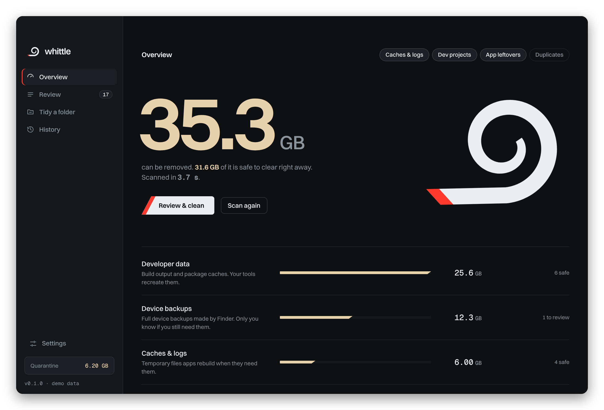
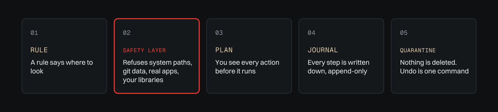
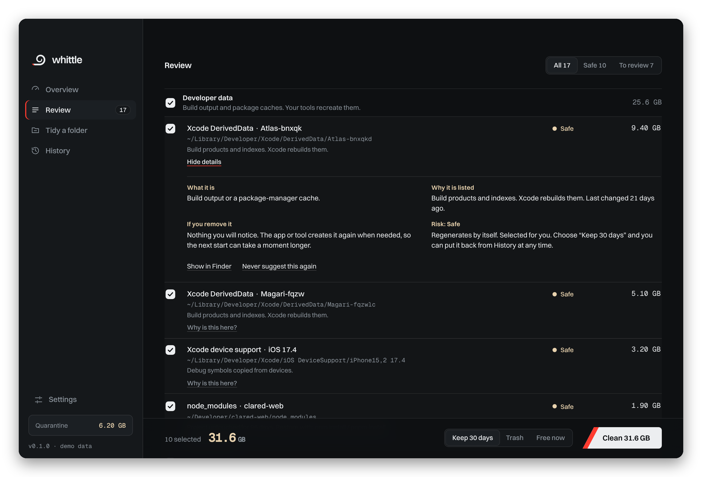
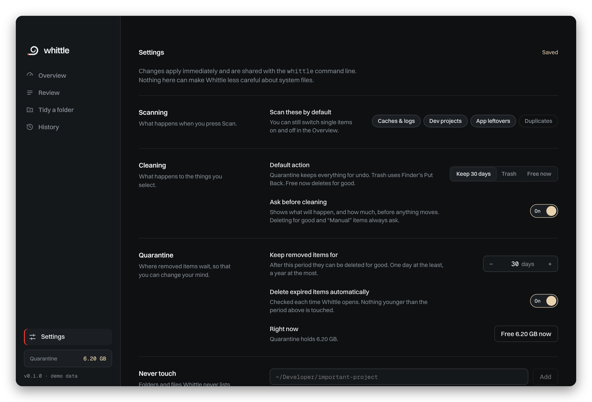
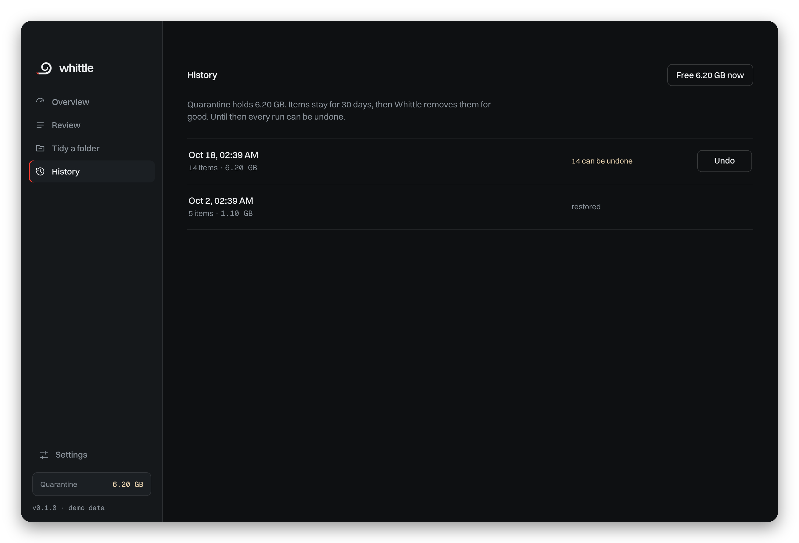
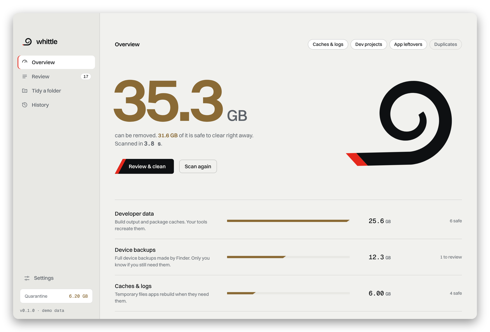
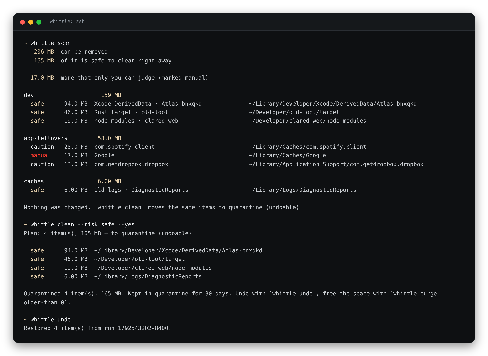

<p align="center">
  <picture>
    <source media="(prefers-color-scheme: dark)" srcset="assets/readme/banner-dark.svg">
    <source media="(prefers-color-scheme: light)" srcset="assets/readme/banner-light.svg">
    
  </picture>
</p>

<p align="center">
  <a href="https://github.com/clezcoding/whittle/actions/workflows/ci.yml"></a>
  <a href="https://github.com/clezcoding/whittle/releases/latest"></a>
  
  
  <a href="LICENSE-MIT"></a>
</p>

<p align="center">
  <a href="README.md">English</a> · <b>Deutsch</b>
</p>

<p align="center">
  <b>Ein Schweizer Taschenmesser für deinen Mac.</b><br>
  Whittle findet, was deinstallierte Apps zurückgelassen haben, räumt Caches und Build-Ordner weg,<br>
  die sich von selbst neu aufbauen, und sortiert unordentliche Ordner. Nichts wird gelöscht, ohne dass es einen Weg zurück gibt.
</p>

<p align="center">
  <picture>
    <source media="(prefers-color-scheme: dark)" srcset="docs/screenshots/overview-dark.png">
    <source media="(prefers-color-scheme: light)" srcset="docs/screenshots/overview-light.png">
    
  </picture>
</p>

> **Status: 0.1, früh.** Kern, Kommandozeile und App funktionieren und sind getestet. Die App ist aber noch nicht mit einer Apple-Developer-ID signiert. Den einmaligen Schritt dafür findest du unter [Installation](#installation). Rückmeldungen und Fehlerberichte sind sehr willkommen.

---

## Inhalt

[Was es kann](#was-es-kann) · [Sicherheit](#sicherheit-ist-das-produkt) · [Die App](#die-app) · [Die Kommandozeile](#die-kommandozeile) · [Installation](#installation) · [Einstellungen](#einstellungen) · [Regeln](#regeln-sind-daten-kein-code) · [FAQ](#faq) · [Roadmap](#roadmap) · [Mitmachen](#mitmachen)

## Was es kann

| | Findet | Typische Größe |
|---|---|---|
| **Caches & Logs** | App-Caches, alte Logs und Absturzberichte, Xcode DerivedData, Device Support und Archive, Simulator-Caches, Homebrew-, npm-, yarn-, pnpm-, pip-, CocoaPods-, Cargo-, Go- und Gradle-Caches, liegengebliebene Installer im Download-Ordner, alte iPhone-Backups | 5 bis 40 GB |
| **Dev-Projekte** | `node_modules`, `target`, `.venv`, `build` und ähnliche Ordner von Projekten, die du länger nicht angefasst hast | 2 bis 30 GB |
| **App-Reste** | Support-Dateien, Caches, Einstellungen und kaputte LaunchAgents von Apps, die nicht mehr installiert sind. Installierte Apps werden aus fünf Quellen erkannt, nicht nur aus `/Applications` | 0,5 bis 10 GB |
| **Duplikate** *(optional)* | Identische Dateien in Downloads, Dokumente, Bilder. Erst nach Größe, dann per schnellem Hash, dann per vollem Hash | variiert |
| **Ordner aufräumen** | Sortiert lose Dateien in Downloads oder Schreibtisch nach Typ und Datum in Unterordner. Screenshots kommen nach Monat, auch mit deutschen und anderen lokalisierten Namen | kein Platz, nur Ordnung |

Jeder Fund kommt mit einer Erklärung in klaren Worten: *was es ist, warum es gelistet wird, was passiert, wenn du es entfernst, und ob Whittle es zurückholen kann*. Kein Eintrag bleibt ein Rätsel.

Das Risiko ist ein Wort und eine Form, nie nur eine Farbe:

| | Bedeutung | Vorausgewählt? |
|---|---|---|
| ● **Sicher** | Entsteht von selbst neu (Caches, Build-Ordner). | Ja |
| ◐ **Prüfen** | Wahrscheinlich unnötig, etwa Daten einer deinstallierten App. | Nein |
| ○ **Manuell** | Nur du weißt es (Geräte-Backups, Ordner, die Whittle nicht einordnen kann). Zählt nicht in die Schlagzeile. | Nein |

## Sicherheit ist das Produkt

Ein Aufräumprogramm ist nur so gut wie sein schlechtester Tag. Whittle ist so gebaut, dass ein Fehler in einer Regel nicht deinen Tag ruinieren kann.

<p align="center">
  <picture>
    <source media="(prefers-color-scheme: dark)" srcset="assets/readme/flow-dark.svg">
    <source media="(prefers-color-scheme: light)" srcset="assets/readme/flow-light.svg">
    
  </picture>
</p>

- **Standardmäßig Quarantäne.** *Aufräumen* verschiebt Einträge nach `~/.whittle/quarantine/` und behält sie 30 Tage (einstellbar von 1 bis 365). `whittle undo` oder ein Klick in der App holt sie zurück. Papierkorb und endgültiges Löschen sind ausdrückliche Entscheidungen.
- **Vorschau, bevor etwas passiert.** `scan` ändert nichts. `clean --dry-run` zeigt den Plan. Die App fragt vor dem Aufräumen nach, und immer vor dem endgültigen Löschen.
- **Eine Verweigerungsschicht unter jeder Aktion.** Systempfade, dein Home-Ordner samt seinen Hauptordnern, Daten anderer Nutzer, `.git`-Ordner, echte `.app`-Bundles, Schlüsselbund, Mail, Fotos und iCloud-Daten werden verweigert, egal was eine Regel sagt. Deine eigene *Nie anfassen*-Liste wird an derselben Stelle durchgesetzt.
- **Die App schickt nie Pfade zum Löschen.** Die Oberfläche schickt IDs von Funden des letzten Scans. Das Rust-Backend schlägt die Pfade selbst nach. Selbst eine gekaperte Web-Ansicht kann also nur auf Gefundenes zugreifen.
- **Journal, das nur wächst.** Jede Änderung steht in `~/.whittle/journal.jsonl`.
- **Kein Netzwerk, keine Telemetrie, kein Konto.** Die Content-Security-Policy der App verbietet Netzwerkanfragen. Whittle spricht nie mit dem Internet.

<p align="center">
  <picture>
    <source media="(prefers-color-scheme: dark)" srcset="assets/readme/layers-dark.svg">
    <source media="(prefers-color-scheme: light)" srcset="assets/readme/layers-light.svg">
    
  </picture>
</p>

## Die App

Whittles Oberfläche ist ein Fenster im macOS-Look, gebaut mit [Tauri](https://tauri.app) (Rust-Backend, React-Frontend). Sie zeigt gemessenen Fortschritt, nie einen Fake-Spinner: Prozent, vergangene Sekunden und Restzeit, je Modul.

<table>
  <tr>
    <td width="50%"><br><sub><b>Prüfen.</b> Jeder Eintrag mit Begründung und den Folgen des Entfernens. An- und abwählen oder <i>Nie wieder vorschlagen</i>.</sub></td>
    <td width="50%"><br><sub><b>Einstellungen.</b> Standardaktion, Quarantänedauer, Nie-anfassen-Liste, Design, Bewegung und ein Check für den Vollzugriff auf die Festplatte.</sub></td>
  </tr>
  <tr>
    <td width="50%"><br><sub><b>Verlauf.</b> Jeder Lauf, rückgängig machbar, solange er in Quarantäne liegt.</sub></td>
    <td width="50%"><br><sub><b>Hell und dunkel.</b> Folgt macOS oder wähle selbst. „Bewegung reduzieren“ wird respektiert.</sub></td>
  </tr>
</table>

Tastatur: `⌘R` scannen · `⌘1` bis `⌘4` Ansichten · `⌘,` Einstellungen · `?` alle Kürzel.

*Hinweis:* Die App-Oberfläche ist derzeit englisch. Die Erklärungen zu jedem Fund ebenso. Eine deutsche Oberfläche steht auf der [Roadmap](docs/ROADMAP.md).

## Die Kommandozeile

Dieselbe Engine, ohne Fenster. Alles ist ein Probelauf, bis du etwas anderes sagst.

<p align="center">
  
</p>

```sh
whittle scan                      # was könnte weg? (ändert nichts)
whittle scan --module orphans     # ein Modul: caches, projects, orphans, dupes
whittle scan --json               # maschinenlesbar
whittle clean --dry-run           # Plan anzeigen
whittle clean                     # sichere Einträge in die Quarantäne, mit Rückfrage
whittle clean --risk caution      # wahrscheinliche Reste einschließen
whittle undo                      # letzten Lauf zurückholen
whittle history                   # was Whittle geändert hat
whittle purge                     # Quarantäne endgültig leeren
whittle tidy ~/Downloads          # Sortierung als Vorschau
whittle tidy ~/Downloads --apply  # ausführen
whittle ignore ~/Developer/keep   # diesen Pfad nie melden oder anfassen (gilt auch in der App)
whittle apps                      # welche installierten Apps Whittle erkennt
whittle rules                     # eingebaute Regeln auflisten
```

## Installation

### Homebrew

```sh
brew tap clezcoding/tap

brew install --cask clezcoding/tap/whittle    # die App
brew install --formula clezcoding/tap/whittle # nur die Kommandozeile
```

### Download

Lade das universelle `.dmg` (Apple Silicon und Intel, macOS 11 oder neuer) vom [neuesten Release](https://github.com/clezcoding/whittle/releases/latest) und ziehe *Whittle* in *Programme*.

> **Erster Start.** Solange die App nicht mit einer Apple-Developer-ID signiert ist, meldet macOS *„Whittle kann nicht geöffnet werden“*. Das ist Gatekeeper, kein Fehler. Rechtsklick auf die App, **Öffnen**, dann noch einmal **Öffnen**. Oder einmalig im Terminal:
> ```sh
> xattr -dr com.apple.quarantine /Applications/Whittle.app
> ```
> Der Homebrew-Cask erledigt das für dich. Jedes Release listet seine SHA-256-Prüfsummen, damit du den Download prüfen kannst.

### Aus dem Quelltext

Du brauchst die Xcode-Kommandozeilentools, [Rust](https://rustup.rs), Node 20+ und pnpm.

```sh
git clone https://github.com/clezcoding/whittle
cd whittle
./scripts/install-mac.sh      # oder doppelklicke "Install Whittle.command"
```

Das baut `Whittle.app`, kopiert sie nach `/Applications`, installiert den Befehl `whittle` und öffnet die App. `--dmg` behält ein Disk-Image, `--no-cli` lässt den Befehl weg.

### Vollzugriff auf die Festplatte (optional)

macOS versteckt einige Ordner (Mail, Nachrichten, Safari) vor jeder App. Damit Whittle auch dort Reste findet, füge es unter *Systemeinstellungen, Datenschutz & Sicherheit, Vollständiger Festplattenzugriff* hinzu. Die Einführung beim ersten Start und die Einstellungsseite prüfen das für dich. Ohne den Zugriff funktioniert Whittle und überspringt, was es nicht lesen kann. Es entfernt deswegen nie mehr.

## Einstellungen

App und Kommandozeile teilen sich eine Datei: `~/.config/whittle/settings.json`. Jede Einstellung gilt sofort. Eine beschädigte Datei fällt auf die Standardwerte zurück und bleibt als `settings.json.broken` erhalten.

| Einstellung | Standard | Wirkung |
|---|---|---|
| Standardaktion | Quarantäne | Was *Aufräumen* tut: Quarantäne, Papierkorb oder sofort löschen |
| Vor dem Aufräumen fragen | an | Ein Zusammenfassungsdialog, bevor etwas verschoben wird |
| Entfernte Einträge behalten | 30 Tage | 1 bis 365 |
| Abgelaufene automatisch löschen | an | Wird beim Öffnen der App geprüft |
| Nie anfassen | leer | Pfade, die nie gelistet und nie verändert werden |
| Standardmäßig scannen | Caches, Projekte, App-Reste | Duplikate sind optional, weil sie viel lesen |
| Design, Bewegung | System | Dunkel, hell, reduzierte Bewegung |

## Regeln sind Daten, kein Code

Wo Whittle sucht, steht in YAML. Ein neuer Cache-Ort ist ein Eintrag und ein Pull Request, kein Rust nötig. Siehe [`rules/README.md`](rules/README.md). Private Regeln liegen in `~/.config/whittle/rules/*.yaml`. Eine Regel mit derselben `id` überschreibt die eingebaute.

```yaml
rules:
  - id: xcode-derived-data
    name: Xcode DerivedData
    category: dev
    risk: safe
    regenerable: true
    note: Build products and indexes. Xcode rebuilds them.
    paths: ["~/Library/Developer/Xcode/DerivedData/*"]
    min_age_days: 7
    platform: macos
```

## FAQ

**Ist es sicher?** Es ist um genau diese Frage herum gebaut: siehe [Sicherheit](#sicherheit-ist-das-produkt). Trotzdem: Lies die Liste, bevor du auf *Aufräumen* drückst, und halte Backups bereit. Kein Werkzeug kennt jede Datei, die dir wichtig ist.

**Warum werden Daten einer App gelistet, obwohl sie installiert ist?** Das sollte nicht passieren. Whittle prüft `/Applications`, Homebrew, Spotlight, Installer-Belege und eingebettete Helfer und liest App-Group-Entitlements. Findest du einen Fehlalarm, wähle *Nie wieder vorschlagen* und [eröffne bitte ein Issue](https://github.com/clezcoding/whittle/issues/new/choose) mit der Ausgabe von `whittle apps`.

**Macht es meinen Mac schneller?** Nicht so, wie „Optimizer“-Apps es versprechen. Es schafft Speicherplatz und räumt auf. Es berührt den Arbeitsspeicher nicht und ist kein Virenscanner.

**Telefoniert es nach Hause?** Nein. Es gibt keinen Netzwerkcode, keine Analytics, keine Update-Prüfung. Updates kommen von GitHub Releases oder Homebrew, wenn du sie willst.

**Warum ist die App nicht signiert?** Signieren und Notarisieren braucht eine kostenpflichtige Apple-Developer-ID. Das steht auf der [Roadmap](docs/ROADMAP.md). Bis dahin gilt der Hinweis zum ersten Start oben.

**Intel-Macs?** Ja. Releases sind Universal-Binaries.

## Roadmap

Signierte und notarisierte Releases, ein pnpm-Migrator für npm-Projekte, Docker- und Runtime-Audit, Port-Inspektor, geplante stille Scans, deutsche Oberfläche. Siehe [`docs/ROADMAP.md`](docs/ROADMAP.md).

## Projektstruktur

```
crates/whittle-core   scannen, planen, anwenden, rückgängig, Sicherheitsschicht, Einstellungen (ohne UI)
crates/whittle-cli    der Befehl `whittle`
apps/gui              Tauri-v2- + React-App (src-tauri ist die dünne Rust-Hülle)
rules/                eingebaute Regeln als YAML
packaging/            Vorlagen für Homebrew-Formel und -Cask
assets/               Logo, Icon und README-Grafiken
docs/                 Designsystem, Architektur, Roadmap, Screenshots
```

[ARCHITECTURE](docs/ARCHITECTURE.md) · [DESIGN](docs/DESIGN.md) · [ROADMAP](docs/ROADMAP.md) · [CHANGELOG](CHANGELOG.md)

## Mitmachen

Fehlerberichte, neue Regeln und Ideen helfen am meisten. Lies [CONTRIBUTING.md](CONTRIBUTING.md). Kurzfassung: `make check` führt aus, was die CI ausführt, und die Oberfläche läuft auch im normalen Browser mit Demodaten (`cd apps/gui && pnpm dev`). Sicherheitslücken bitte nach [SECURITY.md](SECURITY.md) melden und kein öffentliches Issue eröffnen.

## Name

To whittle heißt, ein Stück Holz Span für Span herunterzuschnitzen. Das Logo ist dieser Span, mit dem Schnitt in Rot.

## Lizenz

Doppelt lizenziert unter [MIT](LICENSE-MIT) oder [Apache-2.0](LICENSE-APACHE), nach deiner Wahl. Schriften: Switzer (Indian Type Foundry, über Fontshare) und Geist Mono (SIL OFL). Siehe [`docs/THIRD-PARTY-NOTICES.md`](docs/THIRD-PARTY-NOTICES.md).

<p align="center"><sub>Gemacht von <a href="https://github.com/clezcoding">clezcoding</a> by Puzzless Foundation und Mitwirkenden.</sub></p>
