<p align="center">
  <picture>
    <source media="(prefers-color-scheme: dark)" srcset="assets/readme/banner-dark.svg">
    <source media="(prefers-color-scheme: light)" srcset="assets/readme/banner-light.svg">
    
  </picture>
</p>

<p align="center">
  <a href="https://github.com/clezcoding/whittle/actions/workflows/ci.yml"></a>
  <a href="https://github.com/clezcoding/whittle/actions/workflows/codeql.yml"></a>
  <a href="https://scorecard.dev/viewer/?uri=github.com/clezcoding/whittle"></a>
  <a href="https://github.com/clezcoding/whittle/releases/latest"></a>
  <a href="https://github.com/clezcoding/whittle/releases"></a>
  <a href="https://github.com/clezcoding/whittle/stargazers"></a>
</p>

<p align="center">
  
  
  
  
  
  <a href="https://github.com/clezcoding/homebrew-tap"></a>
  <a href="LICENSE-MIT"></a>
</p>

<p align="center">
  <a href="CONTRIBUTING.md"></a>
  <a href="#safety-is-the-product"></a>
  <a href="https://github.com/clezcoding/whittle/pulls?q=is%3Apr+author%3Aapp%2Fdependabot"></a>
  <a href="https://kodiakhq.com"></a>
  <a href=".pre-commit-config.yaml"></a>
  <a href=".github/workflows"></a>
  <a href="SECURITY.md#verifying-a-release"></a>
  <a href="docs/ASSURANCE.md"></a>
  <a href="docs/OPENSSF.md"></a>
</p>

<p align="center">
  <b>English</b> · <a href="README.de.md">Deutsch</a>
</p>

<p align="center">
  <a href="https://clezcoding.github.io/whittle/"><b>🌐 Website</b></a> &nbsp;·&nbsp; <a href="https://github.com/clezcoding/whittle/releases">Releases</a> &nbsp;·&nbsp; <a href="CHANGELOG.md">Changelog</a> &nbsp;·&nbsp; <a href="SECURITY.md">Security</a> &nbsp;·&nbsp; <a href="docs/ARCHITECTURE.md">Architecture</a>
</p>

<p align="center">
  <b>A Swiss army knife for your Mac.</b><br>
  Whittle finds what uninstalled apps left behind, clears caches and build folders that rebuild themselves,<br>
  and tidies messy folders. Nothing is ever deleted without a way back.
</p>

<p align="center">
  <a href="https://github.com/clezcoding/whittle/releases/latest"><b>⬇ Download for macOS</b></a> &nbsp;·&nbsp; <a href="#homebrew">Homebrew</a> &nbsp;·&nbsp; <a href="#the-command-line">CLI</a> &nbsp;·&nbsp; <a href="#from-source">From source</a> &nbsp;·&nbsp; <a href="https://clezcoding.github.io/whittle/">Website</a>
</p>

```sh
brew tap clezcoding/tap
brew install --cask clezcoding/tap/whittle
```

<p align="center">
  <picture>
    <source media="(prefers-color-scheme: dark)" srcset="docs/screenshots/overview-dark.png">
    <source media="(prefers-color-scheme: light)" srcset="docs/screenshots/overview-light.png">
    
  </picture>
</p>

> **Status: 0.1, early.** The core, the command line and the app work and are tested, but the app is not yet signed with an Apple Developer ID. Read [Install](#install) for the one-time step this needs. Feedback and bug reports are very welcome.

---

## Contents

[Quick start](#quick-start) · [What it does](#what-it-does) · [See it work](#see-it-work) · [Safety](#safety-is-the-product) · [The app](#the-app) · [Shortcuts](#keyboard) · [The command line](#the-command-line) · [Install](#install) · [Settings](#settings) · [Rules](#rules-are-data-not-code) · [FAQ](#faq) · [Roadmap](#roadmap) · [How the project is run](#how-the-project-is-run) · [Contributing](#contributing)

| **Undo, always** | **No network** | **No mystery items** | **Rules are data** |
|---|---|---|---|
| Clean moves to a quarantine. One command or one click puts everything back. | No telemetry, no account, no update check. The app is not allowed to make a request. | Every finding says what it is, why it is listed and what happens if it goes. | Where Whittle looks is YAML. A new cache location is one entry, no Rust. |

## Quick start

```sh
brew tap clezcoding/tap && brew install --cask clezcoding/tap/whittle   # 1. install the app (or --formula for the CLI only)
whittle scan                                                              # 2. see what could go, nothing is touched
whittle clean --dry-run && whittle clean                                  # 3. preview, then move the safe items to quarantine
whittle undo                                                              # 4. changed your mind? put the last run back
```

Prefer a window? Open **Whittle** from Applications, press <kbd>⌘</kbd><kbd>R</kbd> to scan, review, and clean. Same engine, same undo.

## What it does

<p align="center">
  <picture>
    <source media="(prefers-color-scheme: dark)" srcset="assets/readme/modules-dark.svg">
    <source media="(prefers-color-scheme: light)" srcset="assets/readme/modules-light.svg">
    
  </picture>
</p>

| | Finds | Typical size |
|---|---|---|
| **Caches & logs** | App caches, old logs and crash reports, Xcode DerivedData, device support and archives, simulator caches, Homebrew, npm, yarn, pnpm, pip, CocoaPods, Cargo, Go and Gradle caches, installers left in Downloads, old iPhone backups | 5 to 40 GB |
| **Dev projects** | `node_modules`, `target`, `.venv`, `build` and similar folders of projects you have not touched for a while | 2 to 30 GB |
| **App leftovers** | Support files, caches, preferences and broken LaunchAgents of apps that are no longer installed. Installed apps are detected from five sources, not just `/Applications` | 0.5 to 10 GB |
| **Duplicates** *(opt-in)* | Identical files in Downloads, Documents, Pictures. Found by size, then a fast hash, then a full hash | varies |
| **Tidy a folder** | Sorts loose files in Downloads or Desktop into sub-folders by type and date. Screenshots go by month, German and other localized names included | no space, just order |

Every finding comes with a plain-language reason: *what it is, why it is listed, what happens if you remove it, whether Whittle can bring it back*. No item is a mystery.

Risk is a word and a shape, never only a colour:

<p align="center">
  <picture>
    <source media="(prefers-color-scheme: dark)" srcset="assets/readme/risk-dark.svg">
    <source media="(prefers-color-scheme: light)" srcset="assets/readme/risk-light.svg">
    
  </picture>
</p>

| | Meaning | Selected for you? |
|---|---|---|
| ● **Safe** | Regenerates on its own (caches, build folders). | Yes |
| ◐ **Review** | Probably unneeded, for example data of an app you uninstalled. | No |
| ○ **Manual** | Only you know (device backups, folders Whittle cannot place). Not counted in the headline number. | No |

## See it work

A scan reads, measures and explains. Nothing moves until you press *Clean*, and *Undo* brings it back. (Illustrative numbers; the picture loops and respects reduced motion.)

<p align="center">
  <picture>
    <source media="(prefers-color-scheme: dark)" srcset="assets/readme/scan-dark.svg">
    <source media="(prefers-color-scheme: light)" srcset="assets/readme/scan-light.svg">
    
  </picture>
</p>

## Safety is the product

A cleaner is only as good as its worst day. Whittle is built so that a bug in a rule cannot ruin one.

<p align="center">
  <picture>
    <source media="(prefers-color-scheme: dark)" srcset="assets/readme/flow-dark.svg">
    <source media="(prefers-color-scheme: light)" srcset="assets/readme/flow-light.svg">
    
  </picture>
</p>

- **Quarantine by default.** *Clean* moves items to `~/.whittle/quarantine/` and keeps them for 30 days (you choose 1 to 365). `whittle undo` or one click in the app puts them back. Trash and permanent delete are explicit choices.
- **Preview before anything happens.** `scan` changes nothing. `clean --dry-run` shows the plan. The app asks before it cleans, and always before deleting for good.
- **A refusal layer under every action.** System paths, your home folder and its top-level folders, other users' data, `.git` folders, real `.app` bundles, Keychains, Mail, Photos and iCloud data are refused, whatever a rule says. Your own *Never touch* list is enforced in the same place.
- **The app never sends paths to delete.** The interface sends ids of findings from the last scan. The Rust backend looks the paths up itself, so even a compromised web view can only act on what a scan found.
- **Append-only journal.** Every change is recorded in `~/.whittle/journal.jsonl`.
- **No network, no telemetry, no account.** The app's content-security policy forbids network requests. Whittle never talks to the internet.

<p align="center">
  <picture>
    <source media="(prefers-color-scheme: dark)" srcset="assets/readme/layers-dark.svg">
    <source media="(prefers-color-scheme: light)" srcset="assets/readme/layers-light.svg">
    
  </picture>
</p>

## The app

Whittle's interface is a native-feeling macOS window built with [Tauri](https://tauri.app) (Rust backend, React front end). It shows measured progress, never a fake spinner: percentage, seconds elapsed and time left, per module. Every screen below is the real interface running on demo data.

<p align="center">
  <picture>
    <source media="(prefers-color-scheme: dark)" srcset="assets/readme/views-dark.svg">
    <source media="(prefers-color-scheme: light)" srcset="assets/readme/views-light.svg">
    
  </picture>
</p>

One big number, a dense honest table, and a drawer that explains any row. Eight views, each one `⌘`-number away, and a command palette for everything else.

### The views

<table>
  <tr>
    <td width="50%"><br><sub><b>Overview.</b> One number: what can go, split by category, with risk as a word and a shape.</sub></td>
    <td width="50%"><br><sub><b>Review.</b> Every item, a reason for each, and what happens if you remove it. Tick, untick, or <i>Never suggest this again</i>.</sub></td>
  </tr>
  <tr>
    <td width="50%">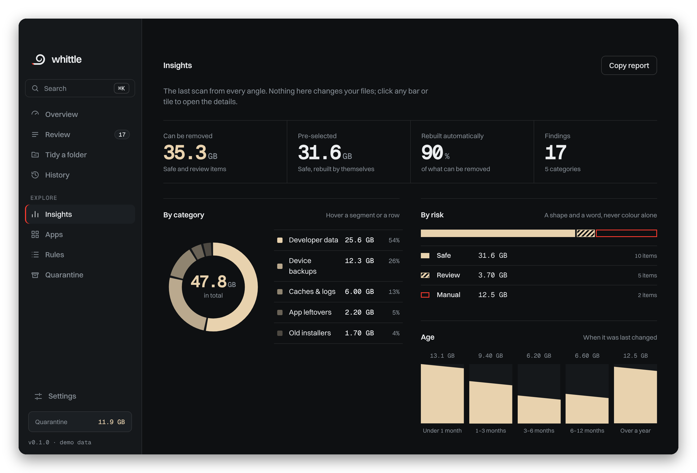<br><sub><b>Insights.</b> Where the space sits, by category, by risk and by age, the biggest single items, and a report you can copy.</sub></td>
    <td width="50%">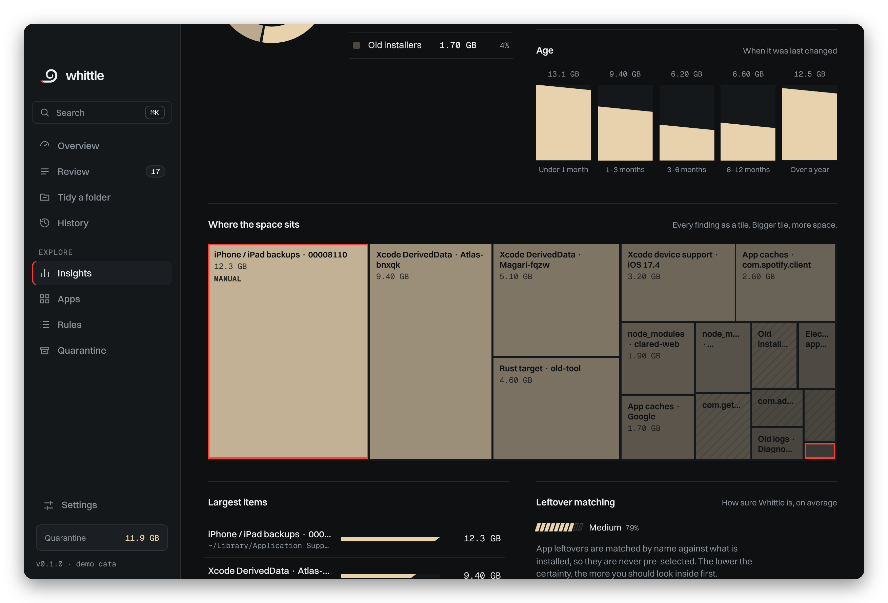<br><sub><b>Treemap.</b> Every finding as a rectangle, area equals size. Click one to open its details.</sub></td>
  </tr>
  <tr>
    <td width="50%">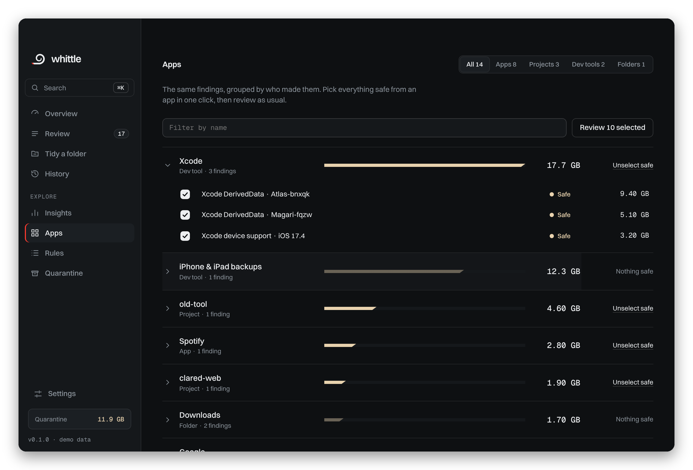<br><sub><b>Apps.</b> Leftovers grouped by the app they belonged to, with a confidence for each.</sub></td>
    <td width="50%">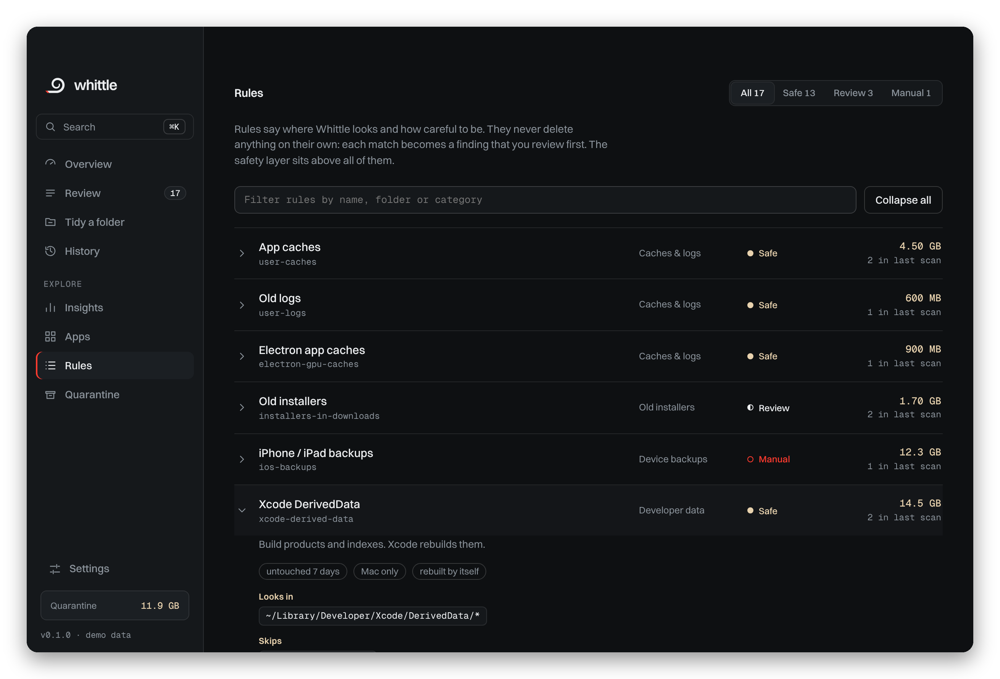<br><sub><b>Rules.</b> Nothing is hidden: paths, exclusions, risk, minimum age and size of every rule.</sub></td>
  </tr>
  <tr>
    <td width="50%">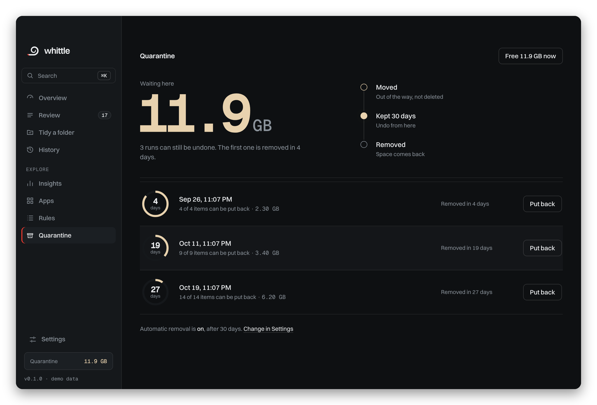<br><sub><b>Quarantine.</b> What can still come back, and in plain words when it is freed.</sub></td>
    <td width="50%">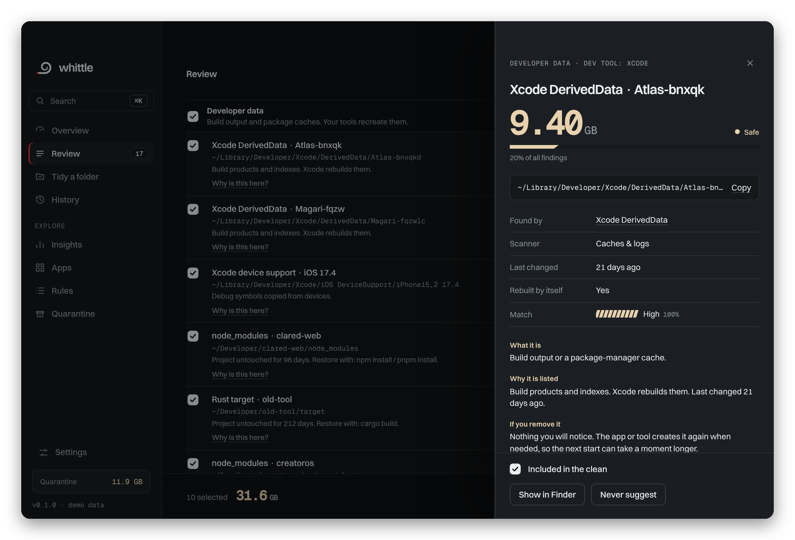<br><sub><b>Details drawer.</b> Double-click a row: what it is, why it is listed, what happens if it goes, how to undo.</sub></td>
  </tr>
  <tr>
    <td width="50%"><br><sub><b>History.</b> Every run, with undo while it is in quarantine.</sub></td>
    <td width="50%"><br><sub><b>Settings.</b> Default action, quarantine period, a never-touch list, theme, motion and a Full Disk Access check.</sub></td>
  </tr>
</table>

### Command palette

<p align="center">
  <picture>
    <source media="(prefers-color-scheme: dark)" srcset="assets/readme/palette-dark.svg">
    <source media="(prefers-color-scheme: light)" srcset="assets/readme/palette-light.svg">
    
  </picture>
</p>

Press `⌘K` and type. Views, actions, appearance, individual findings and rules are all in one fuzzy, forgiving list. It finds `xcode` in a rule name and a finding path, and it does not match scattered letters by accident.

<p align="center">
  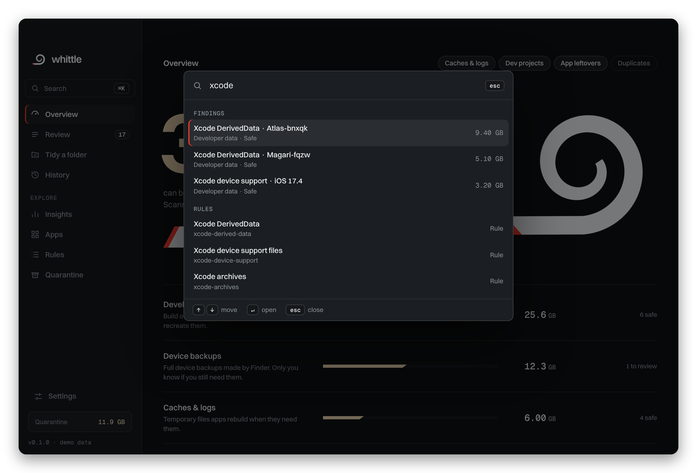
</p>

### Light and dark

Follows macOS, or pick one in Settings. Reduced motion is respected everywhere.

<table>
  <tr>
    <td width="50%"></td>
    <td width="50%">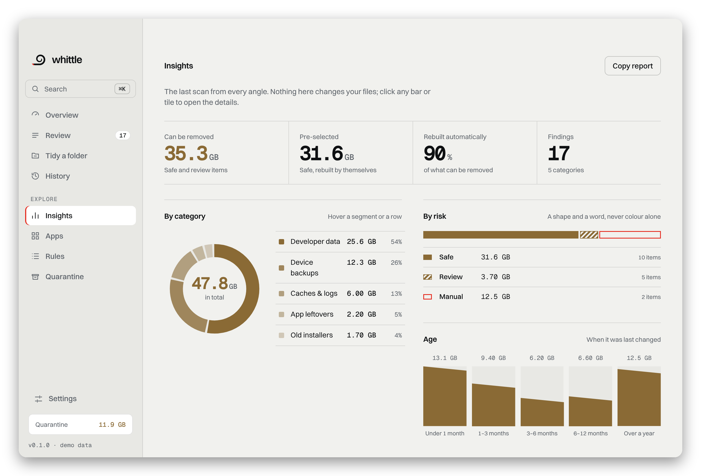</td>
  </tr>
</table>

### Keyboard

| Keys | What it does |
|---|---|
| `⌘K` | Search and commands |
| `⌘R` | Scan |
| `⌘1` … `⌘8` | Overview, Review, Tidy, History, Insights, Apps, Rules, Quarantine |
| `⌘,` | Settings |
| `?` | All shortcuts |
| `Esc` | Close a dialog or the drawer |

## The command line

The same engine, without the window. Everything is a dry run until you say otherwise.

<p align="center">
  <picture>
    <source media="(prefers-color-scheme: dark)" srcset="assets/readme/terminal-dark.svg">
    <source media="(prefers-color-scheme: light)" srcset="assets/readme/terminal-light.svg">
    
  </picture>
</p>

<details>
<summary><b>All commands</b></summary>

```sh
whittle scan                      # what could go? (changes nothing)
whittle scan --module orphans     # one module: caches, projects, orphans, dupes
whittle scan --json               # machine-readable
whittle clean --dry-run           # show the plan
whittle clean                     # safe items to quarantine, with a confirmation
whittle clean --risk caution      # include probable leftovers
whittle undo                      # put the last run back
whittle history                   # what Whittle changed
whittle purge                     # free the quarantine for good
whittle tidy ~/Downloads          # preview a sort
whittle tidy ~/Downloads --apply  # do it
whittle ignore ~/Developer/keep   # never report or touch this path (shared with the app)
whittle apps                      # which installed apps Whittle detects
whittle rules                     # list the built-in rules
```

</details>

## Install

### Homebrew

```sh
brew tap clezcoding/tap

brew install --cask clezcoding/tap/whittle    # the app
brew install --formula clezcoding/tap/whittle # the command line only
```

### Download

Grab the universal `.dmg` (Apple silicon and Intel, macOS 11 or later) from the [latest release](https://github.com/clezcoding/whittle/releases/latest), drag *Whittle* to *Applications*.

> **First launch.** Until the app is signed with an Apple Developer ID, macOS shows *"Whittle can't be opened"*. This is Gatekeeper, not a bug. Right-click the app, choose **Open**, then **Open** again. Or run once:
> ```sh
> xattr -dr com.apple.quarantine /Applications/Whittle.app
> ```
> The Homebrew cask does this for you. Every release lists its SHA-256 checksums so you can verify the download.

### From source

You need the Xcode command line tools, [Rust](https://rustup.rs), Node 20+ and pnpm.

```sh
git clone https://github.com/clezcoding/whittle
cd whittle
./scripts/install-mac.sh      # or double-click "Install Whittle.command"
```

This builds `Whittle.app`, copies it to `/Applications`, installs the `whittle` command and opens the app. `--dmg` keeps a disk image, `--no-cli` skips the command.

### Full Disk Access (optional)

macOS hides some folders (Mail, Messages, Safari) from every app. To let Whittle see leftovers there too, add it under *System Settings, Privacy & Security, Full Disk Access*. The app's first-run guide and its Settings page check this for you. Without it Whittle works and skips what it cannot read. It never removes more because of it.

## Settings

The app and the command line share one file, `~/.config/whittle/settings.json`. Every setting applies immediately; damaged files fall back to the defaults and are kept as `settings.json.broken`.

<details>
<summary><b>All settings</b></summary>

| Setting | Default | What it does |
|---|---|---|
| Default action | Quarantine | What *Clean* does: quarantine, Trash, or delete now |
| Ask before cleaning | on | A summary dialog before anything moves |
| Keep removed items for | 30 days | 1 to 365 |
| Delete expired items automatically | on | Checked when the app opens |
| Never touch | empty | Paths that are never listed and never changed |
| Scan by default | caches, projects, orphans | Duplicates are opt-in because they read a lot |
| Theme, motion | system | Dark, light, reduced motion |

</details>

## Rules are data, not code

Where Whittle looks is written in YAML. A new cache location is one entry and one pull request, no Rust needed. See [`rules/README.md`](rules/README.md). Private rules go in `~/.config/whittle/rules/*.yaml`; a rule with the same `id` overrides the built-in one.

```yaml
rules:
  - id: xcode-derived-data
    name: Xcode DerivedData
    category: dev
    risk: safe
    regenerable: true
    note: Build products and indexes. Xcode rebuilds them.
    paths: ["~/Library/Developer/Xcode/DerivedData/*"]
    min_age_days: 7
    platform: macos
```

## FAQ

<details>
<summary><b>Is it safe?</b></summary>

It is designed around that question: see [Safety](#safety-is-the-product). Even so, read the list before you press *Clean*, and keep backups. No tool can know every file you care about.

</details>

<details>
<summary><b>Why is an app's data listed when the app is installed?</b></summary>

It should not be. Whittle checks `/Applications`, Homebrew, Spotlight, installer receipts and embedded helpers, and reads app-group entitlements. If you find a false positive, choose *Never suggest this again* and please [open an issue](https://github.com/clezcoding/whittle/issues/new/choose) with `whittle apps` output.

</details>

<details>
<summary><b>Does it speed up my Mac?</b></summary>

Not in the way "optimizer" apps promise. It frees disk space and removes clutter. It does not touch RAM, and it is not an antivirus.

</details>

<details>
<summary><b>Does it phone home?</b></summary>

No. There is no network code, no analytics, no update check. Updates come from GitHub Releases or Homebrew, when you ask for them.

</details>

<details>
<summary><b>Why is the app unsigned?</b></summary>

Signing and notarization need a paid Apple Developer ID. It is on the [roadmap](docs/ROADMAP.md); until then see the first-launch note above.

</details>

<details>
<summary><b>Intel Macs?</b></summary>

Yes. Releases are universal binaries.

</details>


## Roadmap

| | |
|---|---|
| ✅ **Shipped (0.1)** | Core engine, command line, desktop app with eight views and a command palette, quarantine and undo, Homebrew tap, universal DMG, signed releases |
| 🔜 **Next** | Signed and notarized releases, a pnpm migrator for npm projects, a German interface |
| 🧭 **Later** | Docker and runtimes audit, a port inspector, scheduled quiet scans |

Details and reasons: [`docs/ROADMAP.md`](docs/ROADMAP.md).

## Project layout

<p align="center">
  <picture>
    <source media="(prefers-color-scheme: dark)" srcset="assets/readme/arch-dark.svg">
    <source media="(prefers-color-scheme: light)" srcset="assets/readme/arch-light.svg">
    
  </picture>
</p>

```
crates/whittle-core   scan, plan, apply, undo, safety layer, settings (no UI)
crates/whittle-cli    the `whittle` command
apps/gui              Tauri v2 + React app (src-tauri is the thin Rust shell)
rules/                built-in rules as YAML
packaging/            Homebrew formula and cask templates
assets/               logo, icon and README artwork
docs/                 design system, architecture, roadmap, screenshots
```

[ARCHITECTURE](docs/ARCHITECTURE.md) · [DESIGN](docs/DESIGN.md) · [ROADMAP](docs/ROADMAP.md) · [CHANGELOG](CHANGELOG.md)

## How the project is run

Whittle is built in the open and tries to be as careful about its own supply chain as it is about your files.

| | |
|---|---|
| **One required check** | *CI passed* gates `main`. Pull requests that only touch docs skip the heavy jobs; code changes run Rust (macOS and Linux), the interface, the desktop shell, licences and advisories and a real `.app` bundle, in parallel, in about three minutes. |
| **Automerge** | [Kodiak](https://kodiakhq.com) squash-merges a pull request labelled `automerge` once CI is green. Dependabot patch and minor updates get that label by themselves; majors and Tauri bumps wait for a person. Config: [`.kodiak.toml`](.kodiak.toml). |
| **Supply chain** | Every GitHub Action is pinned to a commit SHA, runners are hardened, [CodeQL](.github/workflows/codeql.yml), [OpenSSF Scorecard](https://scorecard.dev/viewer/?uri=github.com/clezcoding/whittle), dependency review and `cargo deny` run on every change, and Dependabot keeps it all current. |
| **Releases** | A `v*` tag builds the universal DMG and the command-line archives, then writes SHA-256 sums, a software bill of materials, a Sigstore signature per file and build provenance, and updates the Homebrew tap. [How to verify a download](SECURITY.md#verifying-a-release) · [`docs/RELEASING.md`](docs/RELEASING.md). |
| **Testing** | Unit and integration tests, property tests for the safety layer, three fuzz targets with AddressSanitizer ([`fuzz/`](fuzz)), and a coverage floor of 80 % of lines. |
| **Security practice** | Written [assurance case](docs/ASSURANCE.md) with threat model, a criterion-by-criterion [OpenSSF Best Practices checklist](docs/OPENSSF.md), [governance](GOVERNANCE.md), a [security policy](SECURITY.md) with response times, and zizmor linting of every workflow. |
| **Website** | The [project site](https://clezcoding.github.io/whittle/) is built from [`site/`](site) by the [Pages workflow](.github/workflows/pages.yml). Pull requests only build it; deploys happen from `main`. |
| **Labels** | Pull requests are labelled from the files they touch (`rust`, `frontend`, `tauri`, `rule`, `safety`, `security`, `ci`, `release`, `documentation` …) and the release notes are grouped by them. |

## Contributing

Bug reports, new rules and ideas are the most useful things you can send. Read [CONTRIBUTING.md](CONTRIBUTING.md); the short version: `make check` runs what CI runs, and the interface also runs in a plain browser with demo data (`cd apps/gui && pnpm dev`). Security issues: please follow [SECURITY.md](SECURITY.md) and do not open a public issue.

## Name

To whittle is to carve a piece of wood down, one shaving at a time. The logo is that shaving, with the cut in red.

## License

Dual-licensed under [MIT](LICENSE-MIT) or [Apache-2.0](LICENSE-APACHE), at your option. Typefaces: Switzer (Indian Type Foundry, via Fontshare) and Geist Mono (SIL OFL). See [`docs/THIRD-PARTY-NOTICES.md`](docs/THIRD-PARTY-NOTICES.md).

<p align="center"><sub>Made by <a href="https://github.com/clezcoding">clezcoding</a> by Puzzless Foundation, and contributors.</sub></p>
